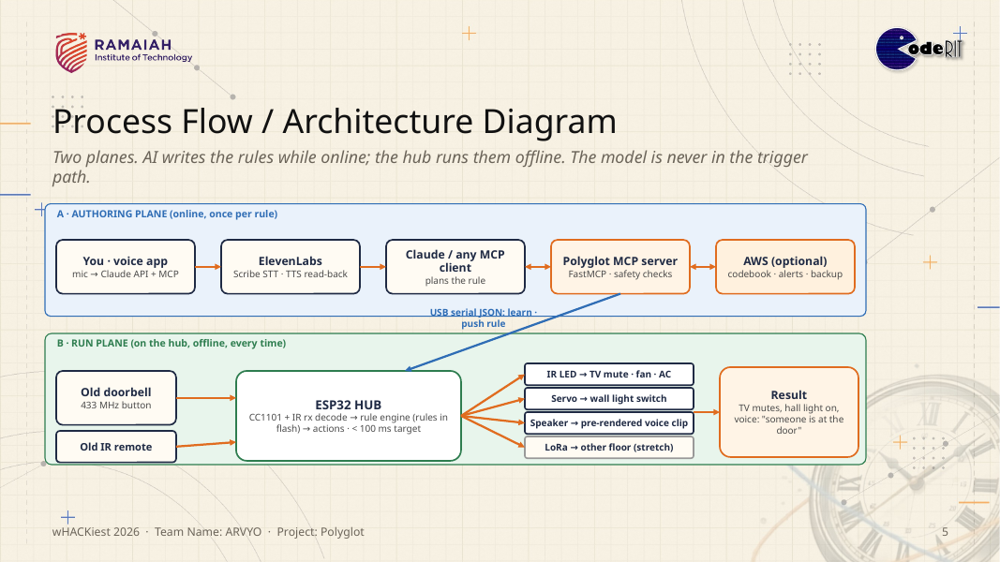

# Polyglot

**Teach your home once. Then just say it.**

Polyglot is an MCP bridge that lets an AI assistant use the dumb devices people already own: the fan, the AC, the TV, a ₹250 wireless doorbell, a wall switch. Press an old remote once and the hub learns it. Then say how things should work together, in English, Hindi or Kannada. The rules run on the hub itself, offline, with no AI in the loop.

> **Status: blueprint.** This repo is Team ARVYO's Round 1 submission for **wHACKiest 2026 (CodeRIT, RIT Bengaluru), Track 1: Make MCP Matter**. The event's no-code rule means nothing is built before the 24-hour hackathon on 1–2 Dec 2026, so this repo holds the design only. Every latency or accuracy number below is a **target** we will measure on hack day, not a result.

- 📑 Deck: [`deck/ARVYO_Track1.pdf`](deck/ARVYO_Track1.pdf)
- 🧭 Architecture and interfaces: [`docs/ARCHITECTURE.md`](docs/ARCHITECTURE.md)
- 🛡️ Safety model: [`docs/SAFETY.md`](docs/SAFETY.md)
- 🗓️ Hack-day plan: [`docs/HACKDAY_PLAN.md`](docs/HACKDAY_PLAN.md)
- 📚 Sources for every number: [`docs/SOURCES.md`](docs/SOURCES.md)

## The problem

Amma is 72 and lives alone. Her TV is loud, so she doesn't hear the doorbell. Her fan, AC, TV and doorbell all still work, but none of them can talk to each other or to an AI. They don't speak Wi-Fi. They speak infrared and 433 MHz radio.

Smart-home penetration in India is estimated at about 8–10% (Redseer, CY2023), and India sold 12.5 million+ room ACs in FY25 alone (ICRA), each driven by an IR remote. The usual fix, "buy smart appliances", means replacing machines that still work.

## How it works

| Step | What happens |
|---|---|
| **1 · Teach** | "Learn this as doorbell," then press it once. An ESP32 hears the burst through a CC1101 (433 MHz) or an IR receiver. A proven decoder (rc-switch / IRremoteESP8266) turns the pulses into a code, and the Polyglot MCP server registers it. Remote buttons become MCP tools (`tv_mute`); signals like the doorbell become **triggers**. |
| **2 · Say** | "When the doorbell rings, mute the TV, switch on the hall light, and tell Amma someone is at the door." ElevenLabs Scribe turns speech into text, Claude turns the text into a rule through `create_rule`, and Polyglot **reads the rule back** before saving it. |
| **3 · Live** | Close the laptop. The rule is stored in the hub's flash. Doorbell pressed → the hub decodes it → an IR LED mutes the TV → a servo flips the wall switch → a pre-rendered voice clip plays. No internet, no cloud, no AI in the loop. Target: under 100 ms. |

## Why it is different

- **Dumb signals become triggers.** IR/RF hubs mostly *send* buttons; Polyglot also *listens*, so a ₹250 doorbell can start a rule.
- **Rules from plain speech, through MCP.** The user keeps the assistant they already use; any MCP client can see the house as tools.
- **Runs without the AI.** The model writes rules; the hub executes them. The model is never on the trigger path.
- **Controlled by design.** It only sends codes taught in this home, so the AI cannot invent one. It refuses rolling codes (same button, different payload). Physical actions need a second yes, and every action is logged. See [SAFETY.md](docs/SAFETY.md).

Honest comparison: Home Assistant + ESPHome can do much of this with a home server and YAML setup; Flipper Zero MCP servers capture and replay but have no rule engine; Broadlink/SwitchBot-style hubs send buttons from an app or a voice assistant.

## Stack (planned)

| Layer | Choice |
|---|---|
| Hub hardware | ESP32 · CC1101 433 MHz · TSOP38238 IR receiver · 940 nm IR LED · MG90S servo · MAX98357A I2S speaker (≈ ₹900 of core parts) |
| Firmware | Arduino-ESP32 · IRremoteESP8266 · rc-switch + SmartRC-CC1101 · rules in NVS flash |
| MCP server | Python · FastMCP · pyserial |
| AI client | Claude Code / Claude Desktop / any MCP client; small voice app (Claude API + MCP) for spoken rules |
| Voice | ElevenLabs Scribe v2 Realtime (STT) · ElevenLabs TTS (read-back + announcement clips) |
| Cloud (optional) | AWS Lambda + DynamoDB opt-in IR codebook · SNS family alerts · S3 rule backup |
| Visualiser | Browser page over WebSocket: live pulses, decoded address vs command, rules firing |
| Stretch | LoRa node at 865–867 MHz (licence-exempt in India), RadioLib |

## Team ARVYO (NMIT Bengaluru)

Nikhil A V (lead) · Shreyas R · Koustav Dey · Shaun Nihal
